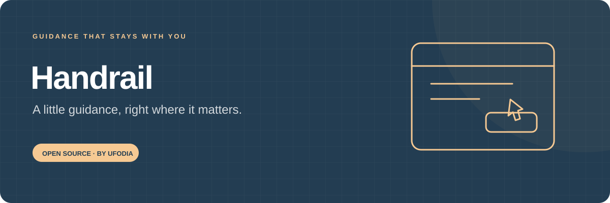
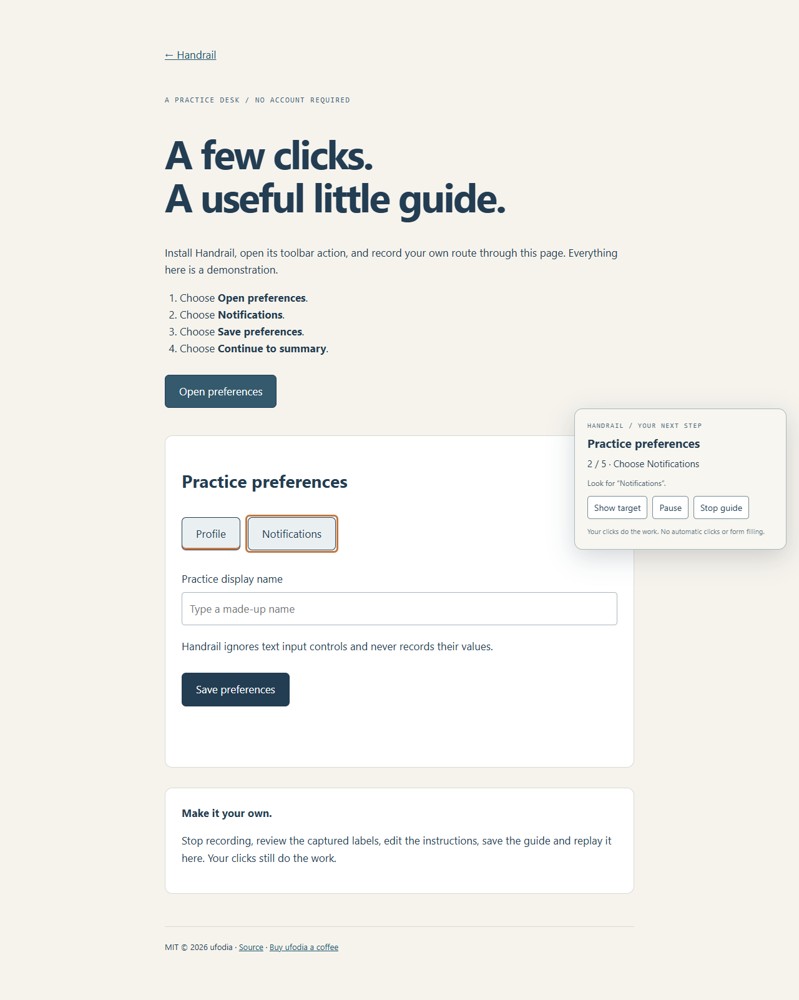

<p align="center">
  
</p>

# Handrail

[](LICENSE)
[](docs/privacy.md)

**Show a web task once. Leave a guide beside the next button.** Handrail records your own clicks on ordinary buttons and links, then highlights those controls when someone follows the guide. The person makes every click.

[First guide](docs/guide.md) · [Permissions and privacy](docs/privacy.md) · [How it works](docs/architecture.md) · [Contribute](CONTRIBUTING.md)

<p>
  <a href="https://buymeacoffee.com/ufodia"></a>
</p>



## Help that stays next to the task

“Which button was it?” is a small question that can interrupt an otherwise familiar task. A screen recording makes someone search a video. A written list can drift away from the page. Handrail puts a short instruction beside a highlighted control on the actual site.

Make a guide for a recurring work task, a family member's familiar website or a small tutorial you want someone to follow independently. Add instructions in your own words, save the guide locally, and export a JSON file when you choose to share it.

| Show                                         | Explain                                | Follow                                | Keep                                   |
| -------------------------------------------- | -------------------------------------- | ------------------------------------- | -------------------------------------- |
| Record your own clicks on supported controls | Edit a short instruction for each step | Click the highlighted target yourself | Save locally or export reviewable JSON |

Handrail does not click buttons, fill forms or submit a task for the person following it. It uses temporary active-tab access and keeps saved guides in this browser's extension-local storage.

## Build and install

You need **Node.js 24 LTS**, Git and a desktop Chromium browser that supports Manifest V3. The extension targets Chrome/Edge-style extension APIs; the automated browser environment uses bundled Chromium. Compatibility with your browser version and target websites still needs checking.

```sh
git clone https://github.com/ufodia/handrail.git
cd handrail
npm ci
npm run build
```

The build creates `extension-dist/`, a complete unpacked extension, and `public/downloads/handrail.zip`. It also builds the public installation/practice site into `dist/`.

1. Open `chrome://extensions` in Chrome or `edge://extensions` in Edge.
2. Enable **Developer mode** and choose **Load unpacked**.
3. Select this project's **extension-dist** folder, which contains `manifest.json`.
4. Open an ordinary HTTP(S) page and invoke **Handrail — your next step** from the toolbar.

Keep the selected extension folder in place. If you use the generated ZIP instead, extract it first and load the folder containing `manifest.json`. This project supplies a manual-install package; it is not a Chrome Web Store listing.

On Windows, use `npm.cmd` if PowerShell blocks `npm.ps1`. [The guide](docs/guide.md) explains recording and replay in detail.

## Try a quiet first task

Run `npm run dev` after the build and open the printed local address's `/practice.html` page. The practice desk has no account or server-backed settings.

Open Handrail from the toolbar, enter a **Guide name**, and choose **Start recording**. Close the popup and click **Open preferences**, **Notifications**, **Save preferences**, and **Continue to summary** on the practice page. On the summary page, click **Finish practice**, then choose **Save recording** in Handrail.

Select the saved guide, choose **Edit instructions**, and give each step a useful sentence. Return to the practice desk, reload it to reset the demonstration state, invoke Handrail there, and choose **Follow this guide**. Your own clicks advance the highlight.

## What you can do in 0.1.0

- Record supported button/link clicks on one exact HTTP(S) origin.
- Capture up to 40 steps per guide and keep up to 20 saved guides.
- Pause, resume, save or discard a recording.
- Follow a guide through same-origin pages while temporary access remains valid.
- Pause when a target is missing, ambiguous, hidden, disabled or no longer has its recorded identity.
- Edit guide names, descriptions and step instructions, or remove an unneeded step.
- Import and export bounded version 1 JSON guides.
- Use **Show target** to scroll to the highlighted control without activating it.

## Three permissions, an explicit start

| Permission  | Purpose                                                                               |
| ----------- | ------------------------------------------------------------------------------------- |
| `activeTab` | Temporary access after you invoke the extension on the current tab                    |
| `scripting` | Inject the local guide overlay into that permitted top-level document                 |
| `storage`   | Keep saved guides locally and retain the current session while the browser is running |

The manifest requests no permanent access to every website, no remote service and no externally connectable messaging. A different origin revokes the temporary page grant; return to the guide's site and invoke Handrail again before resuming. [Privacy details](docs/privacy.md) explain exactly what a guide can contain.

## Know where a guide stops

Handrail uses exact origin/path identity and a unique selector plus target tag, role and label. Website redesigns and translated or changed labels can require recording a step again. It does not distinguish pages by query strings or fragments, so those alone cannot describe different application states.

The first version operates in the top-level page's ordinary DOM. Restricted browser pages, embedded frames, shadow-root controls, text fields, editable content and private/sensitive controls are outside its recording scope. It is a guidance tool, not an accessibility certification or a guarantee that a website's task is safe.

Although input values are not recorded, element labels, IDs, selectors, paths and your instructions can contain private page context. **Review exported guides before sharing them.**

## Check a change

```sh
npm run verify
npx playwright install --no-shell chromium
npm run test:e2e
```

`verify` runs strict TypeScript, unit tests, the extension build and the static-site build. Browser testing uses an isolated bundled Chromium profile; it should never install test builds into your everyday signed-in browser. See [testing](docs/testing.md) for the distinction between extension validation and target-site compatibility.

## Documentation

| You want to…                               | Start here                           |
| ------------------------------------------ | ------------------------------------ |
| Install, record and follow a guide         | [User guide](docs/guide.md)          |
| Understand state, matching and page access | [Architecture](docs/architecture.md) |
| Inspect schema, limits and messages        | [Reference](docs/reference.md)       |
| Review captured data and permissions       | [Privacy](docs/privacy.md)           |
| Reproduce verification                     | [Testing](docs/testing.md)           |
| Restore the project and your library       | [Restoration](docs/restore.md)       |
| Host the installation site and ZIP         | [Deployment](docs/deployment.md)     |

## Keep the small, useful things going

If Handrail makes a familiar task easier for someone, a coffee supports browser compatibility work, regression checks and clear instructions. Support is voluntary, and everyone receives the same open-source tool.

[Buy ufodia a coffee](https://buymeacoffee.com/ufodia) · [Contribute](CONTRIBUTING.md)

**MIT © 2026 ufodia.** See [LICENSE](LICENSE).
